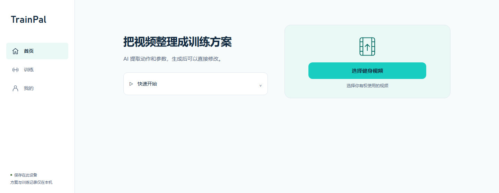
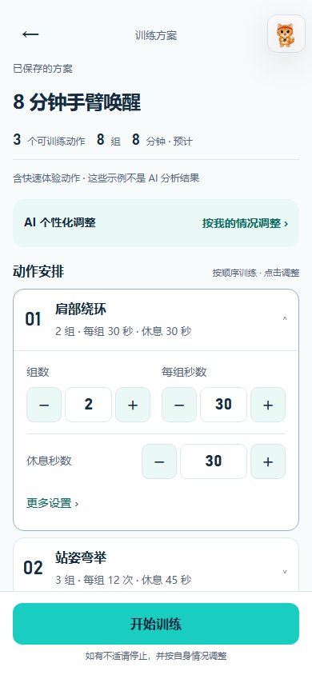
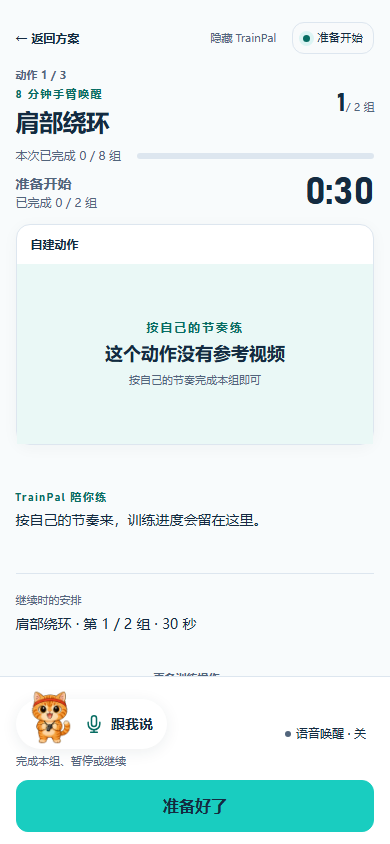
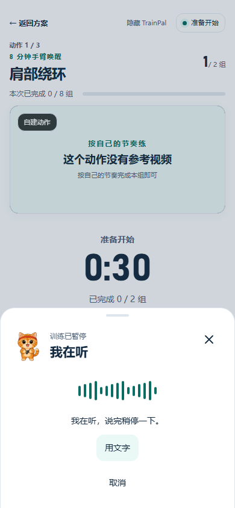

# TrainPal

### 把想练的视频，变成你的训练。

收藏了健身视频，真要练时，还得拖进度条找动作、记组数、算休息。TrainPal 把视频整理成可编辑的训练方案，保留每个动作的来源，再由你选择的小猫陪你练完。

[使用流程](#从视频到一次训练) · [界面预览](#练的时候少碰手机) · [本地运行](#本地运行) · [反馈问题](https://github.com/LittleNuB/TrainPal/issues)

## 从视频到一次训练

1. **选视频，整理动作。** 导入自己有权使用的本地视频，确认后开始分析；查看动作、参数和来源片段，有疑问的动作保留待确认。
2. **展开一个动作，直接改数字。** 组数、次数或时长、休息都能直接输入或加减。其余动作收起，便于在手机上操作。
3. **按自己的情况调整。** 结合可选训练档案、当次时间与状态、已有反馈生成调整建议。你可以继续修改建议，预览后统一应用；手动设置和视频明确要求受到保护。
4. **跟着练，随时停。** 准备倒数、组间休息和下一动作提示连成完整流程；退出后可在同一设备恢复，结束时记录实际完成量。

## 练的时候，少碰手机

小猫旁的 **「跟我说」** 是语音入口。点一下说需求，或主动开启 **语音唤醒** 后喊「TrainPal」。唤醒时训练暂停，底部面板显示正在听、查找进度或一张结果卡；片段可以先预览，再确认使用并继续。

<table>
  <tr><th>展开动作，改数字</th><th>训练与小猫入口</th><th>唤醒后，说一句</th></tr>
  <tr>
    <td></td>
    <td></td>
    <td></td>
  </tr>
</table>

*2026-10-18 产品实屏，使用内置快速开始方案和通过界面选定的热血猫。语音画面采用测试识别事件展示状态；截图不包含用户视频或训练数据。*

可以说「暂停」「继续训练」「回退 5 秒」，也可以查找当前动作已有的讲解片段。文字入口保留在面板里。训练量在方案卡片中修改，语音不会直接改组数或次数。

语音唤醒需要浏览器支持设备上的中文识别，首次可能需要下载语言包；不支持时仍可使用单次说话或文字。唤醒默认关闭，离开或隐藏训练页后停止，返回需重新开启。真实手机、口音和视频外放条件下的效果仍需设备验收。

## AI 理解内容，训练按规则执行

内容理解服务结合语音和画面，输出带时间范围的动作证据。训练编译保留视频要求与规则补全的区别；个性化调整受来源和幅度限制；计时、休息与训练记录由确定性执行器管理。小猫风格影响表达，不决定训练量。

可靠的部分结果会保留，并显示尚未分析到的范围供重试。分析失败不会换成虚构结果。真实分析依赖已配置的内容理解服务；无需服务即可查看明确标注的快速开始方案。

当前重点追踪来源识别与提醒归属的真实质量，以及手机语音体验，详见 [Issues](https://github.com/LittleNuB/TrainPal/issues)。实验模型不作为默认生产 Provider。

## 本地运行

准备 Node.js 24、pnpm 11、Python 3.12 和 [uv](https://docs.astral.sh/uv/)。

~~~powershell
git clone https://github.com/LittleNuB/TrainPal.git
Set-Location TrainPal
pnpm install --frozen-lockfile
uv sync --locked --project services/analysis-api
Copy-Item .env.example .env.local
~~~

在 .env.local 配置 ARK_API_KEY、VOLC_ASR_API_KEY 与对应模型，并准备 FFmpeg；配置项见 [.env.example](.env.example)。GYMTI 的模型增强使用其中独立的 GYMTI 配置。

运行包含分析、语音片段查找和训练提醒编排的本地完整体验：

~~~powershell
pnpm acceptance
~~~

打开 **http://127.0.0.1:15177**。该命令先构建前端，再启动仅监听本机的完整体验入口。未配置密钥时，界面与快速开始可用，相应云端能力会提示不可用。

前端开发可使用 pnpm dev，打开 **http://localhost:5173**；前端为 Vue，后端为 FastAPI。默认开发入口的提醒编排使用本地规则，完整模型编排使用上面的 pnpm acceptance。

示例配置允许最长 300 秒、最大 256 MiB 的视频，实际限制以运行服务返回为准；超过上限需先裁剪。受控示例视频另需配置媒体清单。手机访问和麦克风使用需要适当的 HTTPS 环境。

## 数据留在哪里

原视频、方案、档案和训练记录保存在当前浏览器所在设备，暂不支持跨设备同步。点击分析后，服务端处理临时媒体副本，并把分析所需内容交给配置的服务商；运行结束或取消后清理临时副本、音频、抽帧、转写和模型原文。

语音唤醒在设备上识别；查找片段时发送指令文字。单次说话上传本次录音识别，处理后删除。你可以在「我的」清除本机数据；清除浏览器存储也可能使方案和视频无法恢复。

## 开发与验收

~~~powershell
pnpm api:generate
pnpm check
pnpm --filter @hachimi/web exec playwright install chromium
pnpm test:e2e
~~~

pnpm check 包含 lint、类型检查、单元测试和生产构建。E2E 覆盖完整旅程、响应式布局、键盘与可访问性，使用合成媒体和测试 Provider。真实模型质量和真人麦克风结果单独记录。

[本轮整合与验收记录](docs/design/trainpal-product-integration-20261018.md) · [B 入口设计决策](docs/adr/0088-cat-voice-entry-and-product-integration.md) · [领域词汇](CONTEXT.md)

| 目录 | 内容 |
| --- | --- |
| apps/web/ | 页面、可编辑方案、训练执行与语音入口 |
| services/analysis-api/ | 视频理解、来源片段选择与提醒编排 |
| contracts/、skills/ | 接口合同、问卷与训练领域能力 |
| docs/adr/、docs/design/ | 产品决策、设计与验收记录 |

## License

[MIT](LICENSE) © 2026 Hachimi Contributors
